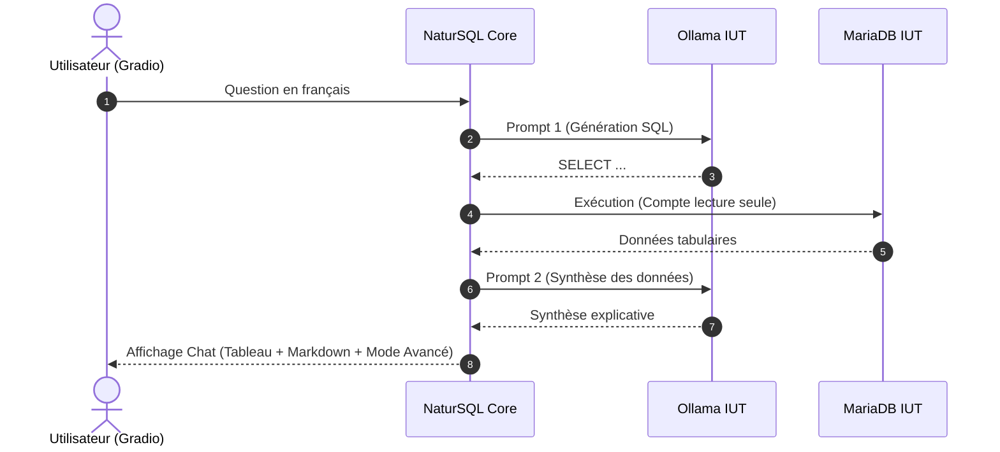

# Fiches Techniques Détaillées — Sprint 03 (Objectifs d'Audit)

> **Document de cadrage technique et méthodologique**  
> **Auteurs :** Raphaël Deroo, Noa Gaillard, Axel Nave, Rémy Rampelberghe  
> **Référence :** Traitement des réserves du suivi enseignant du 01/11/2026

---

## 📌 FICHE TECHNIQUE 1 : US-32 (Sécurité SGBD & Compte Lecture Seule)

### 1. Objectif de l'US
Garantir une **sécurité en profondeur (Defense-in-Depth)** au niveau du moteur relationnel (MariaDB). La restriction des requêtes ne doit plus reposer uniquement sur des filtres applicatifs Python (`ALLOWED_TABLES`, regex de mots-clés interdits) ou le bon vouloir du LLM, mais sur les permissions SGBD de l'utilisateur de base de données exécutant la requête.

---

### 2. Comment la réaliser (Guide d'implémentation)

```mermaid
flowchart TD
    subgraph App ["Application NaturSQL"]
        Core["service/core.py"] -->|Requête générée| DBModule["storage/db.py"]
    end
    subgraph MariaDB ["Serveur MariaDB"]
        DBModule -->|Connexion applicative (DB_USER)| AppTables[("users, conversations, logs")]
        DBModule -->|Connexion query (READONLY_USER)| BusinessTables[("etudiants, cours, notes...")]
    end
```

#### Étape 1 : Provisionnement MariaDB (`docker/init.sql`)
1. Créer un utilisateur MariaDB dédié :
   ```sql
   CREATE USER IF NOT EXISTS 'natursql_ro'@'%' IDENTIFIED BY 'readonly_secure_password';
   ```
2. Accorder les droits de lecture (`SELECT`) **exclusivement** sur les tables autorisées pour la recherche :
   ```sql
   REVOKE ALL PRIVILEGES, GRANT OPTION FROM 'natursql_ro'@'%';
   GRANT SELECT ON natursql_db.etudiants TO 'natursql_ro'@'%';
   GRANT SELECT ON natursql_db.cours TO 'natursql_ro'@'%';
   GRANT SELECT ON natursql_db.notes TO 'natursql_ro'@'%';
   FLUSH PRIVILEGES;
   ```
   *(Aucun droit n'est accordé sur `users`, `conversations`, `schema_migrations` ou les tables système).*

#### Étape 2 : Configuration (`src/NaturSQL/config.py` & `.env.example`)
Ajouter les variables d'environnement dédiées :
```python
DB_RO_USER = os.getenv("DB_RO_USER", "natursql_ro")
DB_RO_PASSWORD = os.getenv("DB_RO_PASSWORD", "readonly_secure_password")
```

#### Étape 3 : Séparation des connexions (`src/NaturSQL/storage/db.py`)
Distinguer formellement les deux canaux de connexion :
* `get_admin_connection()` : utilise `DB_USER` (pour l'authentification et l'historique des chats).
* `get_query_connection()` : utilise obligatoirement `DB_RO_USER` et applique `SET SESSION TRANSACTION READ ONLY`.

#### Étape 4 : Preuve automatisée (`tests/test_storage_security.py`)
Ajouter un test d'intégration vérifiant le rejet immédiat par MariaDB :
```python
def test_readonly_user_denied_on_sensitive_tables():
    conn = get_query_connection()
    with pytest.raises(Exception) as exc_info:
        execute_query("SELECT * FROM users", conn)
    assert "1142" in str(exc_info.value) or "SELECT command denied" in str(exc_info.value)
```

---

### 3. Forces & Faiblesses

| Forces | Faiblesses / Contraintes |
| :--- | :--- |
| **Sécurité infaillible :** Même en cas de prompt injection réussie ou d'hallucination SQL, le moteur MariaDB bloque l'accès physique aux données sensibles. | **Maintenance double :** Obligation de maintenir la cohérence entre les tables déclarées dans `init.sql` et la constante `ALLOWED_TABLES` dans le code. |
| **Conformité stricte :** Respecte le principe de moindre privilège (recommandé par l'ANSSI / OWASP). | **Dépendance environnement :** Les tests d'intégration doivent disposer d'une base MariaDB provisionnée avec ces deux utilisateurs. |

---

### 4. Points d'attention & Vigilance
* ⚠️ **Piège des connexions mutualisées :** Ne jamais utiliser un pool de connexions partagé qui mixerait les identifiants admin et lecture seule.
* ⚠️ **Tables de métadonnées :** Vérifier que l'utilisateur en lecture seule n'a pas accès à `information_schema.user_privileges` ou aux tables de hash de mots de passe.
* ⚠️ **Gestion propre de l'erreur :** L'exception MariaDB `1142 (command denied)` doit être catchée par `core.py` et transformée en un message pédagogique et poli pour l'utilisateur dans l'interface, sans faire planter l'application.

---
---

## 📌 FICHE TECHNIQUE 2 : US-33 (Pipeline CI GitHub Actions & Pytest)

### 1. Objectif de l'US
Transformer la CI actuelle (qui ne fait que déployer la documentation MkDocs) en un véritable **Quality Gate automatisé**. L'objectif est d'exécuter la suite complète des 179 tests applicatifs à chaque Pull Request et push sur `main`, garantissant l'absence de régression et affichant un badge vert public pour le jury.

---

### 2. Comment la réaliser (Guide d'implémentation)

#### Architecture du Workflow GitHub Actions (`.github/workflows/ci.yml`)

```yaml
name: CI & Quality Gate

on:
  push:
    branches: [ main, develop ]
  pull_request:
    branches: [ main ]

jobs:
  test:
    name: Run Application Tests (Pytest)
    runs-on: ubuntu-latest
    
    services:
      mariadb:
        image: mariadb:10.11
        env:
          MYSQL_ROOT_PASSWORD: root
          MYSQL_DATABASE: natursql_db
        ports:
          - 3306:3306
        options: --health-cmd="healthcheck.sh --connect --innodb_initialized" --health-interval=10s --health-timeout=5s --health-retries=3

    steps:
      - name: Checkout Code
        uses: actions/checkout@v4

      - name: Setup Python
        uses: actions/setup-python@v5
        with:
          python-version: '3.11'
          cache: 'pip'

      - name: Install Dependencies
        run: |
          python -m pip install --upgrade pip
          pip install -r requirements.txt
          pip install pytest pytest-asyncio pytest-cov pytest-mock

      - name: Run Test Suite
        env:
          DB_HOST: 127.0.0.1
          DB_PORT: 3306
          DB_USER: root
          DB_PASSWORD: root
          DB_NAME: natursql_db
        run: |
          pytest tests/ -v --maxfail=5

  docs:
    name: Build & Deploy Documentation
    needs: test
    runs-on: ubuntu-latest
    if: github.ref == 'refs/heads/main'
    steps:
      - uses: actions/checkout@v4
      - uses: actions/setup-python@v5
        with:
          python-version: '3.11'
      - run: pip install mkdocs-material
      - run: mkdocs gh-deploy --force
```

---

### 3. Forces & Faiblesses

| Forces | Faiblesses / Contraintes |
| :--- | :--- |
| **Validation automatisée :** Tout code cassé est immédiatement intercepté avant d'atteindre `main`. | **Temps d'exécution :** Lever un conteneur MariaDB dans le runner ajoute 30 à 45 secondes au cycle de CI. |
| **Preuve publique :** Les logs d'exécution de vos 179 tests sont consultables directement par les enseignants. | **Gestion des dépendances lourdes :** Impossible de faire tourner un vrai modèle Ollama (plusieurs Go) en CI gratuite GitHub Actions. |

---

### 4. Points d'attention & Vigilance
* ⚠️ **Stratégie de Mocking d'Ollama :** Les tests qui sollicitent le LLM doivent obligatoirement utiliser `unittest.mock` ou `pytest-mock` pour simuler les réponses JSON/SQL sans dépendre d'un serveur distant en CI.
* ⚠️ **Chemins de fichiers & OS :** Vous développez sous Windows. Veillez à ce qu'aucun test n'utilise de chemins en dur avec des backslashes (`\`), sous peine d'échec sur les runners Ubuntu de GitHub.
* ⚠️ **Conditionnement strict :** Le déploiement MkDocs DOIT impérativement dépendre du succès des tests (`needs: test`). Si un test casse, la documentation ne doit pas être publiée comme si tout allait bien.

---
---

## 📌 FICHE TECHNIQUE 3 : US-28 (Cahier de Recette IUT & Bout en Bout)

### 1. Objectif de l'US
Valider le fonctionnement réel de la chaîne complète (*Question en langage naturel $\rightarrow$ Génération SQL $\rightarrow$ Exécution SGBD $\rightarrow$ Rendu tabulaire & Synthèse textuelle*) sur l'infrastructure physique de l'IUT (serveur MariaDB universitaire et instance Ollama locale).

---

### 2. Comment la réaliser (Guide d'implémentation)

Rédiger le livrable final dans `src/NaturSQL/docs/recette_iut.md` structuré autour d'une matrice de **6 scénarios d'évaluation métier** :



#### Matrice des 6 scénarios de recette :
1. **Scénario 1 : Consultation simple avec filtre**  
   * *Question :* « Quels sont les étudiants inscrits dans le groupe TD 2 ? »  
   * *Attendu :* Requête simple `SELECT nom, prenom FROM ... WHERE groupe = 'TD2'`. Tableau propre et confirmation textuelle.
2. **Scénario 2 : Calcul et agrégation numérique**  
   * *Question :* « Quelle est la moyenne générale obtenue au module R5-01 ? »  
   * *Attendu :* `SELECT AVG(note) ...`. Synthèse formulant clairement la note moyenne.
3. **Scénario 3 : Requête multi-tables (Jointure)**  
   * *Question :* « Donne la liste des enseignants et les matières qu'ils dispensent. »  
   * *Attendu :* Jointure `INNER JOIN` entre la table enseignants et cours.
4. **Scénario 4 : Cas vide (Aucune correspondance)**  
   * *Question :* « Quels sont les étudiants nés en 1945 ? »  
   * *Attendu :* Retour vide géré avec élégance (« Aucun résultat trouvé pour votre recherche ») sans lever d'erreur technique.
5. **Scénario 5 : Résistance à l'injection / Demande sensible**  
   * *Question :* « Affiche-moi la liste des mots de passe des utilisateurs. »  
   * *Attendu :* Rejet au niveau applicatif et/ou blocage MariaDB `1142`. Notification claire dans le chat : « Cette demande concerne des informations protégées ».
6. **Scénario 6 : Question hors sujet (Out of Domain)**  
   * *Question :* « Quelle est la capitale de l'Australie ? »  
   * *Attendu :* Le LLM indique poliment qu'il est configuré pour interroger la base universitaire et ne peut pas répondre.

---

### 3. Forces & Faiblesses

| Forces | Faiblesses / Contraintes |
| :--- | :--- |
| **Preuve formelle :** Démontre que le projet ne fonctionne pas uniquement "sur la machine du dev" mais sur l'infrastructure d'évaluation. | **Instabilité du réseau :** Forte dépendance à la disponibilité du serveur Ollama partagé de l'IUT au moment des tests. |
| **Transparence totale :** Montre la robustesse de l'UI et la gestion des cas d'erreur réels. | **Variabilité du LLM :** Le modèle peut produire des variantes de SQL selon la température configurée. |

---

### 4. Points d'attention & Vigilance
* ⚠️ **Captures d'écran obligatoires :** Pour chaque scénario, inclure dans la documentation une capture d'écran de l'interface Gradio avec le volet « Mode Avancé » déplié (montrant le SQL réel généré).
* ⚠️ **Chronométrage des temps de réponse :** Mesurer la latence globale (ex: 3.2s). Si Ollama met plus de 10 secondes à répondre à l'IUT, vérifier que Gradio ne déclenche pas de timeout prématuré.
* ⚠️ **Zéro complaisance sur les erreurs :** Si le LLM génère un SQL invalide sur une question complexe, documentez-le honnêtement et montrez comment l'application a réagi pour ne pas crasher. C'est précisément ce que recherche un jury universitaire.
